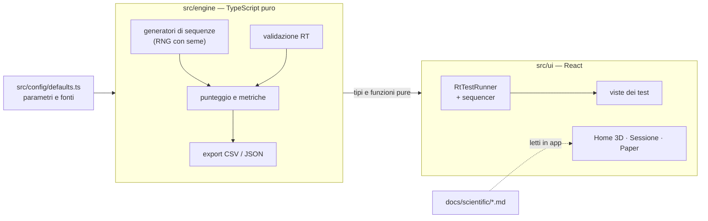

<div align="center">


# Sintropia — Cognitive tests Hub

**Nove test cognitivi classici, con la loro base scientifica, direttamente nel browser.**<br>
Per studiare come l'ambiente fisico influisce sulla mente. Nessun account, nessun server: i dati grezzi restano tuoi.

[](LICENSE)
[](tsconfig.json)
[](https://react.dev)
[](https://vitejs.dev)
[](#dati-e-privacy)
[](#qualità-e-accessibilità)

[Cos'è](#cosè) · [I test](#i-test) · [Modalità Sessione](#modalità-sessione) · [Fondamenti scientifici](#fondamenti-scientifici) · [Avvio rapido](#avvio-rapido) · [Architettura](#architettura) · [Contribuire](#contribuire)


</div>

---

## Cos'è

**Sintropia — Cognitive tests Hub** è una piattaforma web **open source** per somministrare in laboratorio una
batteria di test cognitivi classici e raccoglierne i dati grezzi, trial per trial.

**A cosa serve.** Negli studi di fisica tecnica ambientale (comfort termico, acustico, qualità dell'aria) non basta
misurare la stanza: si vuole sapere se cambia anche il modo in cui le persone rispondono, cioè attenzione, memoria
di lavoro e funzioni esecutive. Sintropia dà allo sperimentatore i paradigmi della psicologia sperimentale già pronti,
con parametri documentati e dati esportabili, e al partecipante un'interfaccia semplice da usare davanti a un computer.

**Come funziona.** Lo sperimentatore sceglie un test (o costruisce una sessione a tempo con più batterie), il
partecipante lo svolge a schermo intero, e alla fine i dati grezzi si scaricano in CSV o JSON per l'analisi statistica.
Tutto avviene nel browser: la piattaforma è una cartella di file statici, senza server da gestire.

**Sviluppata per** il laboratorio CIRIAF COLAB/NEXTROOM.

Tre idee guida:

- **Rigore scientifico visibile.** Ogni test ha un paper con paradigma originale, meccanismo cognitivo, origine di
  ogni parametro, formule delle metriche e limiti. I paper si leggono **dentro la piattaforma** e nel repository.
- **Dati tuoi.** Tutto gira nel browser. Niente account, niente database, niente tracciamento: esporti CSV e JSON.
- **Motore separato dall'interfaccia.** La logica dei test è TypeScript puro, unit-testato e indipendente da React.

## Cosa c'è dentro

<table>
<tr>
<td width="50%"></td>
<td width="50%"></td>
</tr>
<tr>
<td><sub><b>Catalogo.</b> Passando su un test si accende la regione cerebrale associata (mappatura illustrativa, non una localizzazione anatomica).</sub></td>
<td><sub><b>Modalità Sessione.</b> Un protocollo a tempo: fasi, pin <i>t</i>, batterie di test e conto alla rovescia per il partecipante.</sub></td>
</tr>
<tr>
<td></td>
<td></td>
</tr>
<tr>
<td><sub><b>Paper in piattaforma.</b> Formule, tabelle dei parametri e citazioni con DOI, con indice dei paragrafi.</sub></td>
<td><sub><b>Area stimoli.</b> Sfondo bianco e contrasto massimo, come prescrive la specifica di progetto.</sub></td>
</tr>
</table>

## I test

| # | Test | Dominio cognitivo | Fonte primaria | Paper |
|---|------|-------------------|----------------|-------|
| 1 | Stroop 1 — focus parola | Velocità di elaborazione | Stroop (1935) | [stroop](docs/scientific/stroop.md) |
| 2 | Stroop 2 — focus colore | Risoluzione del conflitto | Stroop (1935); MacLeod (1991) | [stroop](docs/scientific/stroop.md) |
| 3 | Go / No-Go | Inibizione motoria rapida | Verbruggen & Logan (2008) | [gonogo](docs/scientific/gonogo.md) |
| 4 | Corsi Block Task | Memoria visuo-spaziale | Corsi (1972); Kessels et al. (2000) | [corsi](docs/scientific/corsi.md) |
| 5 | N-Back (2-back) | Memoria di lavoro | Kirchner (1958); Owen et al. (2005) | [nback](docs/scientific/nback.md) |
| 6 | Wisconsin Card Sorting Test | Flessibilità cognitiva | Berg (1948); Grant & Berg (1948) | [wcst](docs/scientific/wcst.md) |
| 7 | PVT — Vigilanza psicomotoria | Attenzione sostenuta | Dinges & Powell (1985) | [pvt](docs/scientific/pvt.md) |
| 8 | Flanker (frecce di Eriksen) | Attenzione selettiva | Eriksen & Eriksen (1974) | [flanker](docs/scientific/flanker.md) |
| 9 | SART — Attenzione sostenuta alla risposta | Controllo attentivo | Robertson et al. (1997) | [sart](docs/scientific/sart.md) |

In arrivo: Visual Search, Mental Rotation e Trail Making A/B (vedi [Roadmap](#roadmap)).

> **Nota sui paper.** Motori e paper dei test sono stati rivisti nell'ottobre 2026: ogni riferimento con DOI è verificato
> su Crossref, ciò che non si è potuto verificare (per esempio i manuali commerciali) è dichiarato come tale, e le scelte
> di progetto sono distinte dalle fonti. Ogni paper ha una cronologia delle revisioni con i difetti corretti. La
> bibliografia completa è in [`docs/scientific/bibliography.md`](docs/scientific/bibliography.md).

## Modalità Sessione

Oltre ai singoli test c'è la **modalità Sessione**: un protocollo cronometrico in cui lo sperimentatore

1. sceglie la **durata** totale e la divide in **fasi** con un nome (es. Baseline, Esposizione, Recupero);
2. colloca dei **pin *t*** sulla linea temporale, ciascuno con una **batteria** di test e i loro parametri;
3. lascia che il partecipante veda solo la fase corrente e un **conto alla rovescia**, con avviso sonoro allo scadere;
4. a fine protocollo scarica un **JSON di sessione** e un **CSV combinato** (una riga per trial, con fase, pin e test).

La sessione si **riprende** se il browser si chiude.

## Fondamenti scientifici

I paper stanno in [`docs/scientific/`](docs/scientific/) e sono **inclusi nella piattaforma** (pulsante
«Fondamenti scientifici» in home, oppure «Base scientifica del test» dalle istruzioni di ogni test). Sono gli stessi
file markdown: scrivere un nuovo paper lo rende subito leggibile nell'app, formule LaTeX comprese.

Ogni paper segue la stessa struttura: paradigma e citazione primaria, meccanismo cognitivo, parametri con la loro
origine (fonte oppure *scelta di progetto*, dichiarata), mappatura sul codice, metriche con formule, validazione dei
dati, limiti. Il trattamento dei tempi di reazione è in [`validazione-rt.md`](docs/scientific/validazione-rt.md).

## Avvio rapido

```bash
git clone https://github.com/arturograntchiappini-bit/ciriaf-hub-testcognitivi.git
cd ciriaf-hub-testcognitivi
npm install
npm run dev        # sviluppo su http://localhost:5173
```

| Comando | Cosa fa |
|---|---|
| `npm run dev` | server di sviluppo con hot reload |
| `npm run build` | controllo dei tipi e build statica in `dist/` |
| `npm run preview` | anteprima della build di produzione |
| `npm test` | suite di test (Vitest) |
| `npm run typecheck` | solo controllo dei tipi |

Requisiti: **Node.js ≥ 20**. La build in `dist/` è statica: si pubblica su qualunque hosting di file.

**Deploy su Netlify.** Il repository contiene `netlify.toml` (comando `npm run build`, cartella `dist`, Node 20) e
`public/_headers` (Content-Security-Policy restrittiva, HSTS e cache immutabile per gli asset). Basta collegare il
repository a un nuovo sito Netlify: non servono variabili d'ambiente.

## Come si somministra un test

1. Dalla **home** il partecipante sceglie il test indicato dallo sperimentatore.
2. Legge le **istruzioni** e, volendo, la **base scientifica** del test.
3. C'è una breve **pratica con feedback** (saltabile), poi il **test** a schermo intero.
4. A fine test vede le **metriche** da trascrivere e il **codice sessione**, e può scaricare **CSV e JSON** dei dati grezzi.

## Dati e privacy

- Nessun dato personale, nessun account, nessun database, nessuna richiesta di rete durante i test.
- Ogni sessione ha solo un codice anonimo `XXXX-HHMM`.
- I dati grezzi sono **trial per trial**, con i flag di validazione dei tempi di reazione, in **CSV** (per Excel,
  separatore `;`) e **JSON**. Il file contiene anche i parametri usati, così l'esperimento è riproducibile.
- Impostazioni e sessioni in corso restano nel `localStorage` del browser del laboratorio.

## Parametri

Numero di trial, durate, proporzioni e tutto il resto si regolano dal pannello **Impostazioni** e sono scritti in
ogni file esportato. I valori di default sono ancorati alla letteratura; dove sono scelte di progetto, il paper lo
dice.

## Architettura



- **`src/engine`** — logica dei test, validazione dei tempi di reazione, sessioni ed export. Nessuna dipendenza da
  React o dal DOM: ogni funzione è testabile in isolamento.
- **`src/ui`** — schermate, runner dei test a tempo di reazione, scena 3D della home (WebGL diretto, senza
  librerie 3D), lettore dei paper.
- **`src/config`** — parametri di default, ciascuno con la sua fonte.
- **`docs/`** — [architettura](docs/architettura.md), paper scientifici, specifiche e piani di progetto.
- **`revisione-motore/`** — copie autonome (generate dai motori vivi) dei test, per la revisione scientifica; `scripts/sync-revisione-motore.mjs` le rigenera.

Dettagli in [`docs/architettura.md`](docs/architettura.md).

## Aggiungere un test

1. **Motore**: `src/engine/tests/<test>.ts` (generatore, punteggio, metriche) con i suoi test unitari.
2. **Parametri**: default con fonte in `src/config/defaults.ts` e campi in `src/ui/params/paramFields.ts`.
3. **Interfaccia**: una vista in `src/ui/tests/` (per i test a tempo di reazione basta un `RtTestPlan`) e le
   istruzioni in `src/ui/content/instructions.ts`.
4. **Registrazione**: `TestId` in `src/engine/types.ts`, catalogo in `src/ui/router.ts`, `TestHost.tsx`.
5. **Paper**: `docs/scientific/<test>.md` e una riga in `src/ui/science/papers.ts`. Un test del repository
   **fallisce** se un test del catalogo non ha il suo paper.

## Qualità e accessibilità

- **TypeScript strict**, motore con test unitari, suite di test per interfaccia e viste.
- **Accessibilità**: verifica con axe-core (WCAG 2.2 AA) senza violazioni su home e sezione scientifica; bersagli
  touch da 44 px, navigazione da tastiera, `prefers-reduced-motion` rispettato.
- **Prestazioni**: schermate caricate a richiesta (code splitting), scena 3D e formule matematiche caricate solo
  quando servono, font locali.
- **Sicurezza**: nessun HTML grezzo nel rendering dei paper (albero di elementi React), solo link `https` esterni.

## Limiti da conoscere

- Sintropia è uno **strumento di ricerca, non un dispositivo diagnostico**: non produce valutazioni cliniche.
- La precisione dei tempi di reazione in browser dipende da tastiera, schermo e carico del computer. Effetti di
  decine di millisecondi sono misurabili; i valori assoluti **non** sono confrontabili con laboratori a hardware
  dedicato senza calibrazione. Vedi [`validazione-rt.md`](docs/scientific/validazione-rt.md).
- L'angolo visivo degli stimoli dipende da distanza e schermo del partecipante.
- Per confrontare gruppi servono stesso hardware e stessi parametri.

## Roadmap

- [x] SART — Sustained Attention to Response Task (parametri da confrontare con l'articolo originale)
- [ ] Visual Search (Treisman & Gelade)
- [ ] Mental Rotation (Shepard & Metzler)
- [ ] Trail Making A/B
- [x] Revisione scientifica dei motori e dei paper dei test esistenti
- [x] Copie autonome in `revisione-motore/` generate dai motori vivi (`node scripts/sync-revisione-motore.mjs`) e protette da un test di allineamento

## Contribuire

Segnalazioni e proposte sono benvenute tramite
[issue](https://github.com/arturograntchiappini-bit/ciriaf-hub-testcognitivi/issues) e pull request. Per i test
nuovi o le modifiche ai parametri, **cita la fonte** (con DOI) e aggiorna il paper corrispondente.

## Come citare

> Grant Chiappini, A. (2026). *Sintropia - Cognitive tests Hub* [Software open source, licenza MIT].
> https://github.com/arturograntchiappini-bit/ciriaf-hub-testcognitivi

Le fonti scientifiche dei singoli paradigmi vanno citate separatamente: sono nei paper e nella bibliografia.
Il file [`CITATION.cff`](CITATION.cff) permette a GitHub di generare la citazione.

## Licenza

Rilasciato con licenza **MIT** (vedi [`LICENSE`](LICENSE)): puoi usarlo, studiarlo, modificarlo e ridistribuirlo
liberamente, citando l'autore.

## Autore

**Arturo Grant Chiappini** — studente e sviluppatore.
[LinkedIn](https://www.linkedin.com/in/arturo-grant-chiappini/)

Sviluppato per il laboratorio **CIRIAF COLAB/NEXTROOM**.
