<div align="center">

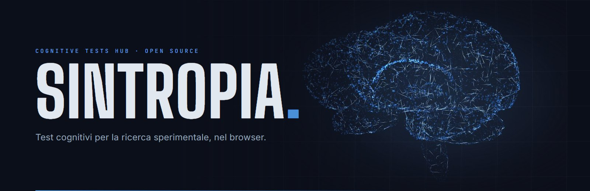

# Sintropia — Cognitive tests Hub

**Dodici test cognitivi classici, con la loro base scientifica, nel browser e come app per Windows.**<br>
Per studiare come l'ambiente fisico influisce sulla mente. Nessun account, nessun server: i dati grezzi restano tuoi.

[](LICENSE)
[](tsconfig.json)
[](desktop/README.md)
[](https://react.dev)
[](#dati-e-privacy)
[](#qualità-e-verifiche)

[Cos'è](#cosè) · [App per Windows](#app-per-windows) · [I test](#i-test) · [Modalità Sessione](#modalità-sessione) · [Fondamenti scientifici](#fondamenti-scientifici) · [Formati di export](#formati-di-export) · [Architettura](#architettura) · [Qualità e verifiche](#qualità-e-verifiche) · [Sviluppo](#sviluppo) · [Licenza](#licenza)

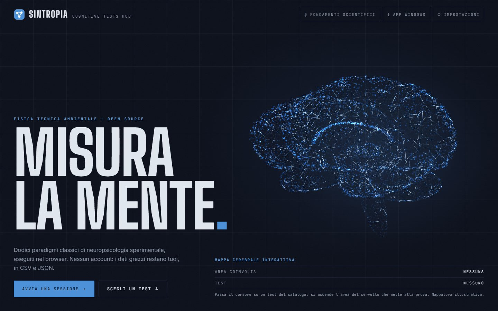

</div>

---

## Cos'è

**Sintropia — Cognitive tests Hub** è una piattaforma **open source** per somministrare in laboratorio una batteria di
test cognitivi classici e raccoglierne i dati grezzi, trial per trial. Esiste in due forme che condividono gli stessi
test, le stesse sequenze a parità di seme e le stesse metriche:

| | Web app | App per Windows |
|---|---|---|
| Come si usa | nel browser, nessuna installazione | programma installato, funziona offline |
| Tecnologia | React + TypeScript | Rust (eframe/egui), motori in Rust |
| Distribuzione | cartella di file statici (Netlify o qualunque hosting) | MSI per utente, zip portatile |

**A cosa serve.** Negli studi di fisica tecnica ambientale (comfort termico, acustico, qualità dell'aria) non basta
misurare la stanza: si vuole sapere se cambia anche il modo in cui le persone rispondono, cioè attenzione, memoria di
lavoro e funzioni esecutive. Sintropia dà allo sperimentatore i paradigmi della psicologia sperimentale già pronti, con
parametri documentati e dati esportabili, e al partecipante un'interfaccia semplice da usare davanti a un computer.

**Come funziona.** Lo sperimentatore sceglie un test (o costruisce una sessione a tempo con più batterie), il
partecipante lo svolge a schermo intero, e alla fine i dati grezzi si scaricano per l'analisi statistica.

**Sviluppata per** il laboratorio CIRIAF COLAB/NEXTROOM.

Tre idee guida:

- **Rigore scientifico visibile.** Ogni test ha un paper con paradigma originale, meccanismo cognitivo, origine di ogni
  parametro, formule delle metriche e limiti. I paper si leggono **dentro la piattaforma** (web e desktop) e nel repository.
- **Dati tuoi.** Niente account, niente database, niente tracciamento: esporti i dati e li porti dove vuoi.
- **Un motore dei test, verificato.** La logica è separata dall'interfaccia. Il motore Rust è stato dimostrato
  equivalente al riferimento TypeScript con fixture golden, fuzz differenziale e test di proprietà
  ([vedi la dimostrazione](docs/scientific/migrazione-rust.md)).

## App per Windows

La stessa dashboard dei test come programma nativo: dashboard, istruzioni, pratica, test a schermo intero, risultati
con export, impostazioni, modalità Sessione e lettore dei paper, con la stessa palette della versione web.

<table>
<tr>
<td width="50%">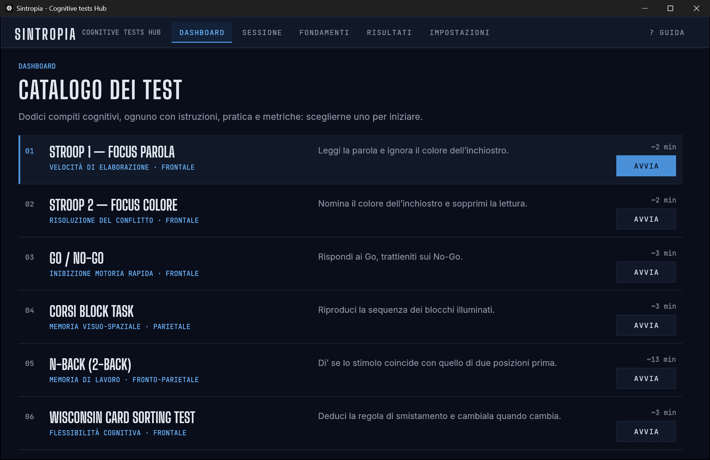</td>
<td width="50%">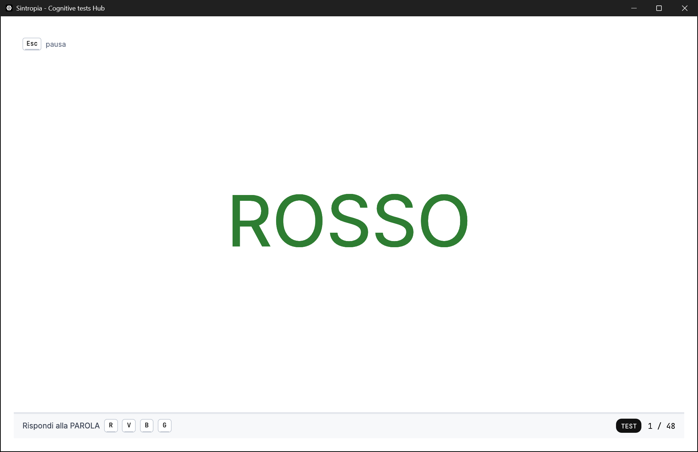</td>
</tr>
<tr>
<td><sub><b>Dashboard.</b> Catalogo dei dodici test con dominio, area cerebrale e durata stimata dai parametri.</sub></td>
<td><sub><b>Test a tutta finestra.</b> Area stimoli bianca, niente distrazioni; <kbd>Esc</kbd> esce, <kbd>F1</kbd> apre la guida.</sub></td>
</tr>
<tr>
<td>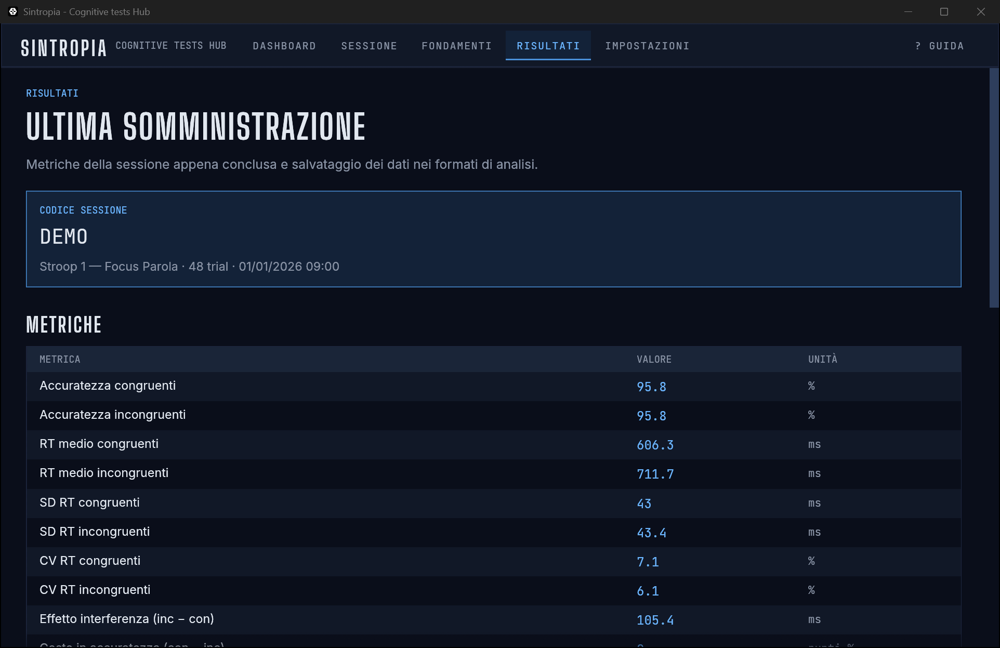</td>
<td>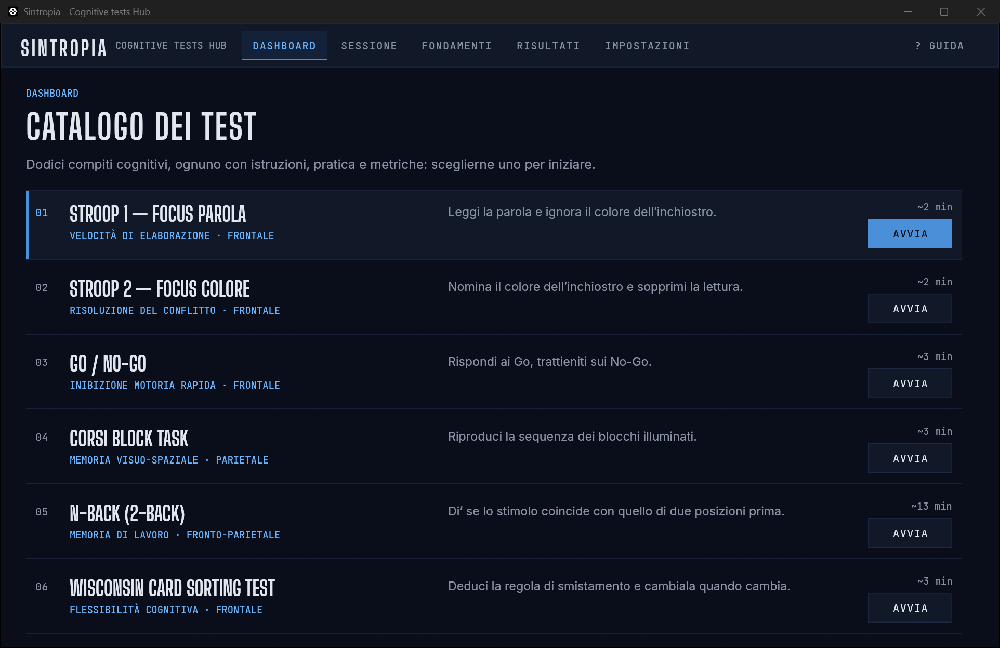</td>
</tr>
<tr>
<td><sub><b>Risultati.</b> Metriche, codice sessione ed export in tutti i formati.</sub></td>
<td><sub><b>Paper integrati.</b> Gli stessi documenti della web app, compresa la dimostrazione della migrazione a Rust.</sub></td>
</tr>
</table>

### Installare

**Dal sito (consigliato).** Nella home della web app, sezione *Sintropia sul tuo computer*, il pulsante **Scarica
l'installer** scarica direttamente `Sintropia-Setup-x64.msi`. Doppio clic e basta: l'installazione è **per utente**, senza
permessi di amministratore, e aggiunge Sintropia al menu Start. Per chi preferisce non installare c'è lo zip portatile.

**Dal repository.** I file sono in [`public/download/`](public/download/), con `SHA256SUMS.txt`:

| File | Cos'è |
|---|---|
| [`Sintropia-Setup-x64.msi`](public/download/Sintropia-Setup-x64.msi) | installer per utente (Windows 10/11, 64 bit) |
| [`Sintropia-Desktop-x64.zip`](public/download/Sintropia-Desktop-x64.zip) | versione portatile, nessuna installazione |
| [`SHA256SUMS.txt`](public/download/SHA256SUMS.txt) | checksum per verificare i file |

**Da terminale (PowerShell, senza amministratore).** Lo script scarica, **verifica lo SHA-256** e installa:

```powershell
# installazione per utente
irm https://raw.githubusercontent.com/arturograntchiappini-bit/ciriaf-hub-testcognitivi/main/scripts/install.ps1 | iex

# oppure, dopo aver scaricato lo script, con le opzioni
.\scripts\install.ps1 -Portable          # zip in %LOCALAPPDATA%\Sintropia, senza MSI
.\scripts\install.ps1 -Uninstall         # rimuove MSI e versione portatile
.\scripts\install.ps1 -InstallerPath .\public\download\Sintropia-Setup-x64.msi   # da file locale
.\scripts\install.ps1 -WhatIf            # mostra cosa farebbe, senza farlo
```

Installazione silenziosa a mano: `msiexec /i Sintropia-Setup-x64.msi /qn`; rimozione: `msiexec /x Sintropia-Setup-x64.msi /qn`.

**Dai sorgenti** (serve [Rust](https://rustup.rs) stabile):

```powershell
cargo install --git https://github.com/arturograntchiappini-bit/ciriaf-hub-testcognitivi sintropia-desktop
# oppure, dal repository clonato:
cd desktop
cargo run --release -p sintropia-desktop
```

> **Avviso di Windows.** Il programma **non è ancora firmato digitalmente**: alla prima esecuzione SmartScreen può
> mostrare «Windows ha protetto il PC» (*Ulteriori informazioni → Esegui comunque*). I checksum permettono di verificare
> che il file sia quello pubblicato. Come ottenere la firma è spiegato in [`desktop/README.md`](desktop/README.md).

L'app accetta opzioni per aprire direttamente una schermata o un test (`--screen`, `--test`, `--size`, `--no-practice`), utili per prove e documentazione.

## Cosa c'è dentro (web)

<table>
<tr>
<td width="50%">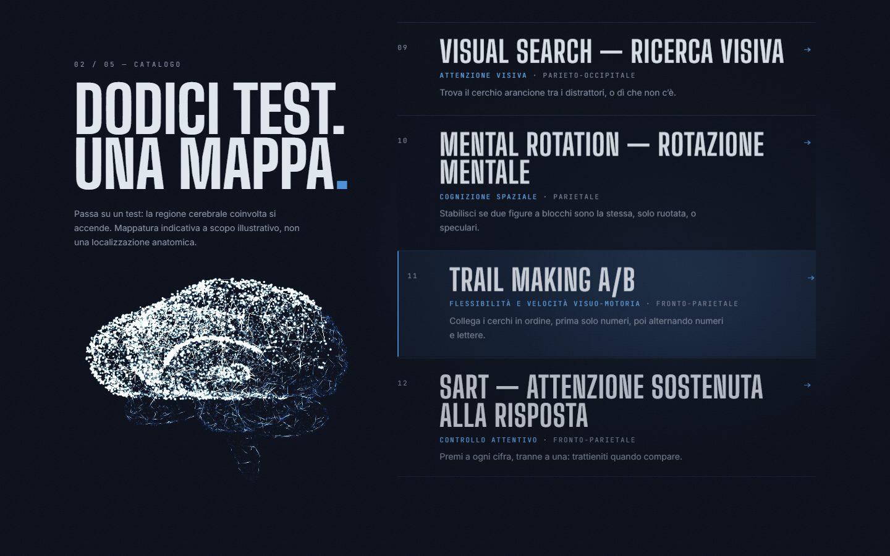</td>
<td width="50%">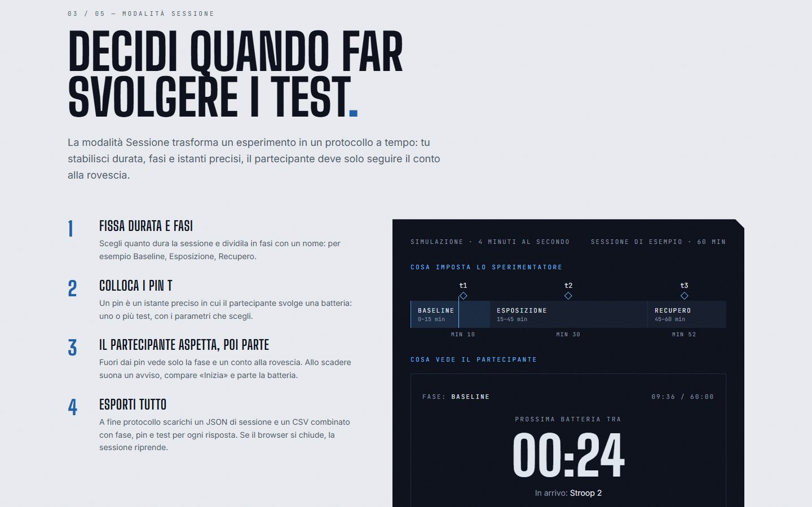</td>
</tr>
<tr>
<td><sub><b>Catalogo.</b> Passando su un test si accende la regione cerebrale associata (mappatura illustrativa, non una localizzazione anatomica).</sub></td>
<td><sub><b>Modalità Sessione.</b> Un protocollo a tempo: fasi, pin <i>t</i>, batterie di test e conto alla rovescia per il partecipante.</sub></td>
</tr>
<tr>
<td>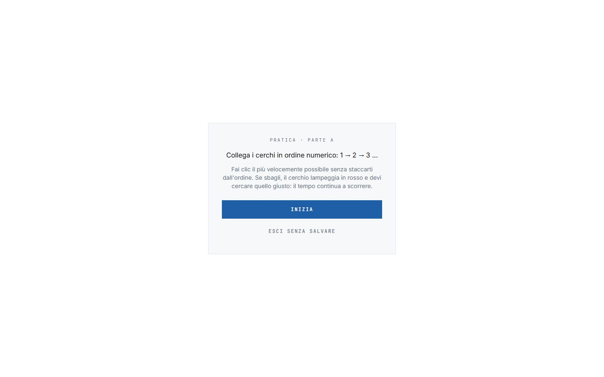</td>
<td>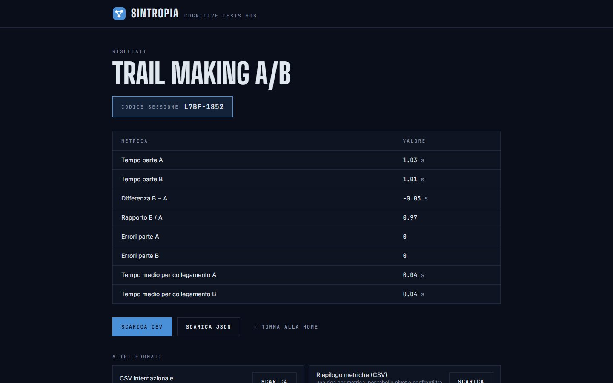</td>
</tr>
<tr>
<td><sub><b>Area stimoli.</b> Sfondo bianco e contrasto massimo, come prescrive la specifica di progetto.</sub></td>
<td><sub><b>Risultati.</b> Metriche da trascrivere, codice sessione e, sotto, gli altri formati di export.</sub></td>
</tr>
<tr>
<td>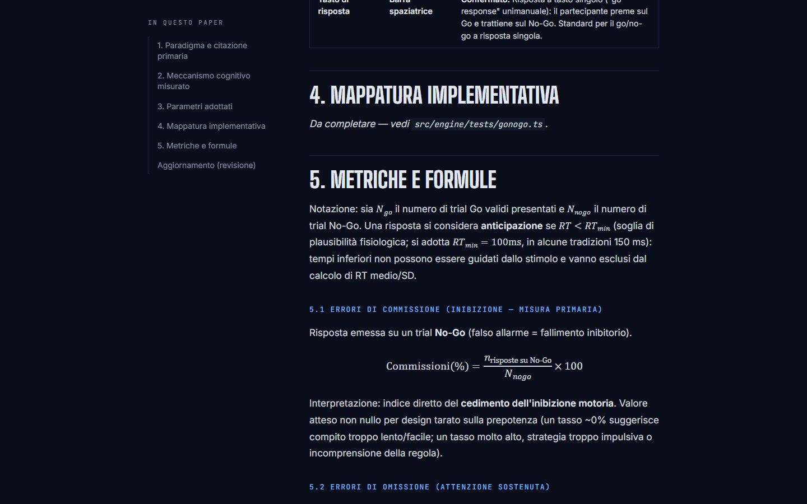</td>
<td>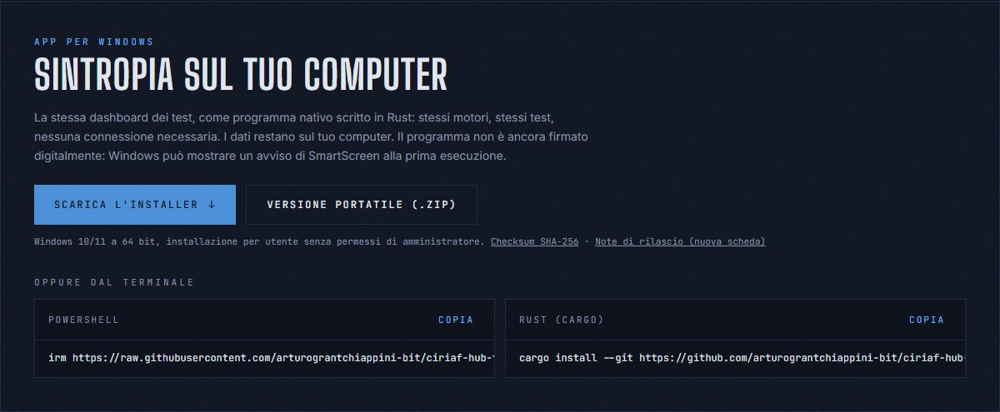</td>
</tr>
<tr>
<td><sub><b>Paper in piattaforma.</b> Formule, tabelle dei parametri e citazioni con DOI, con indice dei paragrafi.</sub></td>
<td><sub><b>Download dell'app.</b> Installer, versione portatile e comandi da copiare.</sub></td>
</tr>
</table>

## I test

| # | Test | Dominio cognitivo | Fonte primaria | Paper |
|---|------|-------------------|----------------|-------|
| 1 | Stroop 1 — focus parola | Velocità di elaborazione | Stroop (1935) | [stroop](docs/scientific/stroop.md) |
| 2 | Stroop 2 — focus colore | Risoluzione del conflitto | Stroop (1935); MacLeod (1991) | [stroop](docs/scientific/stroop.md) |
| 3 | Go / No-Go | Inibizione motoria rapida | Verbruggen & Logan (2008) | [gonogo](docs/scientific/gonogo.md) |
| 4 | Corsi Block Task | Memoria visuo-spaziale | Corsi (1972); Kessels et al. (2000) | [corsi](docs/scientific/corsi.md) |
| 5 | N-Back (2-back) | Memoria di lavoro | Kirchner (1958); Owen et al. (2005) | [nback](docs/scientific/nback.md) |
| 6 | Wisconsin Card Sorting Test | Flessibilità cognitiva | Berg (1948); Grant & Berg (1948) | [wcst](docs/scientific/wcst.md) |
| 7 | PVT — Vigilanza psicomotoria | Attenzione sostenuta | Dinges & Powell (1985) | [pvt](docs/scientific/pvt.md) |
| 8 | Flanker (frecce di Eriksen) | Attenzione selettiva | Eriksen & Eriksen (1974) | [flanker](docs/scientific/flanker.md) |
| 9 | SART — Attenzione sostenuta alla risposta | Controllo attentivo | Robertson et al. (1997) | [sart](docs/scientific/sart.md) |
| 10 | Visual Search — Ricerca visiva | Attenzione visiva | Treisman & Gelade (1980) | [visual-search](docs/scientific/visual-search.md) |
| 11 | Mental Rotation — Rotazione mentale | Cognizione spaziale | Shepard & Metzler (1971) | [mental-rotation](docs/scientific/mental-rotation.md) |
| 12 | Trail Making A/B | Flessibilità e velocità visuo-motoria | Reitan (1958) | [trail-making](docs/scientific/trail-making.md) |

> **Nota sui paper.** Motori e paper dei test sono stati rivisti nell'ottobre 2026: ogni riferimento con DOI è verificato
> su Crossref, ciò che non si è potuto verificare (per esempio i manuali commerciali) è dichiarato come tale, e le scelte
> di progetto sono distinte dalle fonti. Ogni paper ha una cronologia delle revisioni con i difetti corretti. La
> bibliografia completa è in [`docs/scientific/bibliography.md`](docs/scientific/bibliography.md).

### Come si somministra un test

1. Dalla **home** (o dalla dashboard) il partecipante sceglie il test indicato dallo sperimentatore.
2. Legge le **istruzioni** e, volendo, la **base scientifica** del test.
3. C'è una breve **pratica con feedback** (saltabile), poi il **test** a schermo intero.
4. A fine test vede le **metriche** da trascrivere e il **codice sessione**, e scarica i dati grezzi.

I parametri (numero di trial, durate, proporzioni…) si regolano dal pannello **Impostazioni**, sono scritti in ogni file
esportato e hanno default ancorati alla letteratura; dove sono scelte di progetto, il paper lo dice.

## Modalità Sessione

Oltre ai singoli test c'è la **modalità Sessione**: un protocollo cronometrico in cui lo sperimentatore

1. sceglie la **durata** totale e la divide in **fasi** con un nome (es. Baseline, Esposizione, Recupero);
2. colloca dei **pin *t*** sulla linea temporale, ciascuno con una **batteria** di test e i loro parametri;
3. lascia che il partecipante veda solo la fase corrente e un **conto alla rovescia**, con avviso sonoro allo scadere;
4. a fine protocollo scarica un **JSON di sessione** e un **CSV combinato** (una riga per trial, con fase, pin e test).

La sessione si **riprende** se l'applicazione si chiude.

## Fondamenti scientifici

I paper stanno in [`docs/scientific/`](docs/scientific/) e sono **inclusi nella piattaforma** (pulsante «Fondamenti
scientifici» in home, «Base scientifica del test» dalle istruzioni, sezione *Fondamenti* nell'app desktop). Sono gli
stessi file markdown: scrivere un nuovo paper lo rende subito leggibile nell'app, formule LaTeX comprese.

Ogni paper segue la stessa struttura: paradigma e citazione primaria, meccanismo cognitivo, parametri con la loro origine
(fonte oppure *scelta di progetto*, dichiarata), mappatura sul codice, metriche con formule, validazione dei dati,
limiti. Il trattamento dei tempi di reazione è in [`validazione-rt.md`](docs/scientific/validazione-rt.md).

Un documento di metodo, [**Migrazione dei motori da TypeScript a Rust**](docs/scientific/migrazione-rust.md), riporta la
dimostrazione sperimentale che il motore Rust riproduce il riferimento: metodo, divergenze trovate, prestazioni, limiti.

## Formati di export

Dopo ogni test (e a fine sessione) i dati si scaricano in più formati, tutti con parametri, versione del motore
(`engineVersion`) e flag di validazione dei tempi di reazione:

| Formato | Per cosa |
|---|---|
| **CSV** (separatore `;`) | apertura diretta in Excel con locale italiano |
| **CSV internazionale** (separatore `,`) | R, Python, strumenti in locale inglese |
| **Riepilogo metriche (CSV)** | una riga per metrica, per tabelle pivot e confronti |
| **JSON** | dati completi e parametri, riproducibili |
| **Eventi TSV** (stile BIDS) | onset e tempi in secondi, colonne dei file `_events.tsv` |
| **Report HTML** | pagina leggibile da aprire, stampare o salvare in PDF |

Il file esatto dipende dal contesto (singolo test o sessione); l'elenco aggiornato è nella schermata dei risultati.

## Dati e privacy

- Nessun dato personale, nessun account, nessun database, nessuna richiesta di rete durante i test.
- Ogni sessione ha solo un codice anonimo `XXXX-HHMM`.
- I dati grezzi sono **trial per trial**, con i flag di validazione dei tempi di reazione.
- Web: impostazioni e sessioni in corso restano nel `localStorage` del browser. Desktop: in una cartella dati locale
  dell'utente.

## Architettura

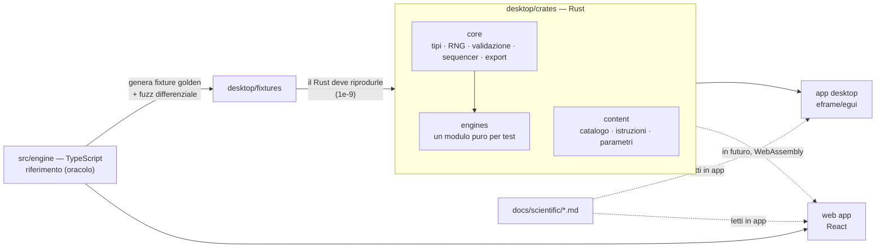

- **`src/engine`** — motori dei test in TypeScript puro (nessuna dipendenza da React o dal DOM). Restano nel repository
  **invariati, come oracolo della migrazione**: [vedi `src/engine/README.md`](src/engine/README.md). Oggi alimentano la web app.
- **`src/ui`** — schermate, runner dei test a tempo di reazione, scena 3D della home (WebGL diretto, senza librerie 3D),
  lettore dei paper. **`src/config`** — parametri di default, ciascuno con la sua fonte.
- **`desktop/crates/core`** — tipi, RNG `mulberry32` identico al TS, validazione RT, SDT, sequencer con orologio iniettato, export, sessioni.
- **`desktop/crates/engines`** — un motore **puro** per test (nessun I/O, tempo o thread): compila anche per
  `wasm32-unknown-unknown`, così lo stesso codice potrà girare nel browser.
- **`desktop/crates/content`** — dati di interfaccia separati dai motori. **`desktop/crates/app`** — GUI eframe/egui.
- **`revisione-motore/`** — copie autonome (generate dai motori vivi) per la revisione scientifica; `scripts/sync-revisione-motore.mjs` le rigenera.
- **`docs/`** — [architettura](docs/architettura.md), paper scientifici, specifiche e piani di progetto.

## Qualità e verifiche

**Equivalenza Rust ↔ TypeScript** (dati completi in [`desktop/fixtures/`](desktop/fixtures/) e nel [paper di migrazione](docs/scientific/migrazione-rust.md)):

- **Fixture golden** generate dal TS per ogni test: sequenze, conteggi e ordini **esattamente** uguali, float entro **1e-9**
  (tolleranza dichiarata in un solo punto), con i casi limite (trial interrotti, omissioni, anticipazioni, liste vuote,
  nessuna commissione, meno di due punti per le regressioni).
- **Fuzz differenziale**: per ogni test circa 500 casi di generazione e 500 di punteggio casuali, eseguiti sia nel TS sia nel Rust e confrontati.
- **Test di proprietà** (proptest) sugli invarianti: bilanciamento, nessuna ripetizione immediata, bersagli attesi, ISI nell'intervallo.
- **Bug del TS trovati dal confronto** sono documentati in [`DIVERGENZE.md`](desktop/fixtures/DIVERGENZE.md): il Rust non li copia; il TS resta invariato come oracolo.
- **Prestazioni**: in generazione e punteggio il Rust nativo è più veloce del TS su tutte le operazioni misurate
  (da circa 1,3× a oltre 30×), e il WebAssembly è comparabile al nativo; metodo e numeri in [`BENCHMARK.md`](desktop/fixtures/BENCHMARK.md).
- `ENGINE_VERSION` è scritta in ogni export, così un dato dichiara con quale motore è stato prodotto.

**Web.** TypeScript strict, test unitari dei motori e test di interfaccia e viste (Vitest); accessibilità verificata con
axe-core (WCAG 2.2 AA), bersagli touch da 44 px, navigazione da tastiera, `prefers-reduced-motion` rispettato;
schermate caricate a richiesta, font locali; nessun HTML grezzo nel rendering dei paper, solo link `https` esterni.

## Sviluppo

Requisiti: **Node.js ≥ 20** (web); **Rust stabile** con target `wasm32-unknown-unknown` per controllare la compilazione WASM (desktop).

```bash
git clone https://github.com/arturograntchiappini-bit/ciriaf-hub-testcognitivi.git
cd ciriaf-hub-testcognitivi
npm install
npm run dev        # web su http://localhost:5173
```

| Comando | Cosa fa |
|---|---|
| `npm run dev` / `npm run build` / `npm run preview` | sviluppo, build statica in `dist/`, anteprima |
| `npm test` / `npm run typecheck` | test (Vitest) e controllo dei tipi |
| `cd desktop && cargo test --workspace --release` | tutti i test Rust (golden, fuzz, proprietà) |
| `cd desktop && cargo check -p sintropia-engines --target wasm32-unknown-unknown` | verifica la compilazione WASM dei motori |
| `node desktop/tools/golden/generate.mjs` | rigenera le fixture golden dal TS |
| `.\desktop\installer\build-installer.ps1` | costruisce MSI, zip e checksum (richiede .NET SDK e WiX) |
| `.\desktop\installer\publish-to-site.ps1` | copia i file in `public/download/` per il sito |

**Deploy su Netlify.** Il repository contiene `netlify.toml` (comando `npm run build`, cartella `dist`, Node 20) e
`public/_headers` (Content-Security-Policy restrittiva, HSTS, cache immutabile per gli asset, intestazioni di download per
`/download/*`). Basta collegare il repository a un nuovo sito: non servono variabili d'ambiente. Installer e zip sono
in `public/download/` e vengono serviti dallo stesso sito.

**Aggiungere un test.**
1. **Motore**: `src/engine/tests/<test>.ts` con test unitari; per il desktop il modulo Rust in `desktop/crates/engines` con la sua fixture golden.
2. **Parametri**: default con fonte in `src/config/defaults.ts` e campi in `src/ui/params/paramFields.ts`.
3. **Interfaccia**: vista in `src/ui/tests/` (per i test a tempo di reazione basta un `RtTestPlan`) e istruzioni in `src/ui/content/instructions.ts`.
4. **Registrazione**: `TestId` in `src/engine/types.ts`, catalogo in `src/ui/router.ts`, `TestHost.tsx`.
5. **Paper**: `docs/scientific/<test>.md` e una riga in `src/ui/science/papers.ts`. Un test del repository **fallisce** se un test del catalogo non ha il suo paper.

## Limiti da conoscere

- Sintropia è uno **strumento di ricerca, non un dispositivo diagnostico**: non produce valutazioni cliniche.
- La precisione dei tempi di reazione dipende da tastiera, schermo e carico del computer (in browser anche dal browser).
  Effetti di decine di millisecondi sono misurabili; i valori assoluti **non** sono confrontabili con laboratori a hardware
  dedicato senza calibrazione. Vedi [`validazione-rt.md`](docs/scientific/validazione-rt.md).
- L'angolo visivo degli stimoli dipende da distanza e schermo del partecipante.
- Per confrontare gruppi servono stesso hardware, stessa versione del motore e stessi parametri.
- L'app per Windows non è firmata digitalmente; la web app non usa ancora il motore Rust (la migrazione verso WebAssembly è il passo successivo).

## Roadmap

- [x] SART, Visual Search, Mental Rotation, Trail Making A/B
- [x] Revisione scientifica dei motori e dei paper dei test esistenti
- [x] Motori in Rust verificati contro il riferimento TypeScript, app desktop, installer per Windows
- [x] Più formati di export (CSV internazionale, riepilogo metriche, eventi TSV, report HTML)
- [ ] Web app sul motore Rust compilato in WebAssembly, poi ritiro del TypeScript
- [ ] Firma del codice dell'installer e rilascio su GitHub Releases

## Contribuire

Segnalazioni e proposte sono benvenute tramite
[issue](https://github.com/arturograntchiappini-bit/ciriaf-hub-testcognitivi/issues) e pull request. Per i test nuovi o
le modifiche ai parametri, **cita la fonte** (con DOI) e aggiorna il paper corrispondente.

## Come citare

> Grant Chiappini, A. (2026). *Sintropia - Cognitive tests Hub* [Software open source, licenza MIT].
> https://github.com/arturograntchiappini-bit/ciriaf-hub-testcognitivi

Le fonti scientifiche dei singoli paradigmi vanno citate separatamente: sono nei paper e nella bibliografia.
Il file [`CITATION.cff`](CITATION.cff) permette a GitHub di generare la citazione.

## Licenza

Rilasciato con licenza **MIT** (vedi [`LICENSE`](LICENSE)): puoi usarlo, studiarlo, modificarlo e ridistribuirlo
liberamente, citando l'autore.

## Autore

**Arturo Grant Chiappini** — studente e sviluppatore.
[LinkedIn](https://www.linkedin.com/in/arturo-grant-chiappini/)

Sviluppato per il laboratorio **CIRIAF COLAB/NEXTROOM**.
